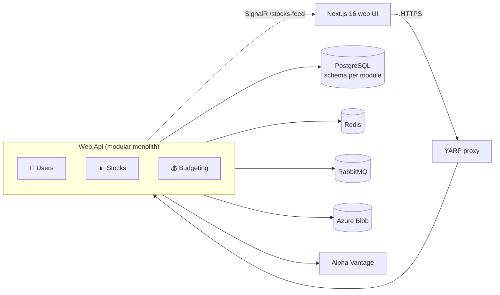

# 📈 Stock Market Simulator

Trade stocks with virtual money against real market data. Each user starts with a **$5,000 budget**, buys and sells real tickers priced by [Alpha Vantage](https://www.alphavantage.co/), and watches prices move live. Between real quotes, prices follow a **Geometric Brownian Motion** model and stream to the browser over SignalR.

The backend is a **.NET 10 modular monolith** built with Clean Architecture, CQRS, a transactional outbox and RabbitMQ. It runs locally with **.NET Aspire**; the front end is **Next.js 16**.

---

## ✨ Features

- **Trading:** buy and sell at server-side prices. Trades check buying power and owned shares, and optimistic concurrency stops concurrent trades from double-spending.
- **Live prices:** a GBM price feed over SignalR. Trades use exactly the price shown on the chart.
- **Portfolio insights:** transaction history with cursor paging, a top performer based on weighted average cost, and an audit log.
- **Accounts:** registration with email verification, JWT access tokens and rotating refresh tokens, permission-based authorization.
- **Social:** public profiles, followers, profile and banner pictures in Azure Blob Storage.
- **Stock search:** full-text search over cached symbols, falling back to Alpha Vantage.
- **Short links:** shareable short URLs, including per-ticker quote links.
- **Operations:** OpenTelemetry tracing and metrics, health checks, Redis-backed rate limiting, idempotent write endpoints, feature flags, API versioning.

## 🧱 Architecture



| Module | Owns |
| --- | --- |
| 👤 **Users** | Registration, email verification, JWT and refresh tokens, permissions, profiles, followers |
| 📊 **Stocks** | Quotes, search, the real-time GBM feed, URL shortening |
| 💰 **Budgeting** | Budgets, buy and sell transactions, audit logs |

Each module has its own Domain, Application and Infrastructure projects and its own PostgreSQL schema. Modules call each other only through small public `*.Api` contracts or through integration events, and architecture tests enforce those boundaries.

**Main patterns:**

- CQRS with a decorator pipeline: logging, query caching, exception handling, validation.
- `Result` types instead of exceptions for business errors.
- Domain events through a transactional outbox, with idempotent consumers.
- Integration events over RabbitMQ.
- Quartz.NET for background work.

➡️ More in [docs/architecture.md](docs/architecture.md) and [docs/events-and-background-jobs.md](docs/events-and-background-jobs.md).

## 🛠️ Tech stack

| Area | Technologies |
| --- | --- |
| Backend | .NET 10, ASP.NET Core minimal APIs, SignalR, FluentValidation, Scrutor |
| Data | PostgreSQL, EF Core 10 (Npgsql), Dapper, Redis |
| Messaging and jobs | RabbitMQ, Quartz.NET 4, transactional outbox |
| Hosting | .NET Aspire 13, YARP, Docker |
| Observability | OpenTelemetry, health checks, Sentry |
| API docs | OpenAPI, Swagger UI, Scalar, ReDoc |
| Storage and email | Azure Blob Storage (Azurite locally), MailKit |
| Front end | Next.js 16, React 19, tRPC, TanStack Query, Tailwind CSS 4, shadcn/ui, Recharts, Auth.js |
| Testing | xUnit, NSubstitute, NetArchTest, Testcontainers |

## 🚀 Quick start

**Prerequisites:** [.NET 10 SDK](https://dotnet.microsoft.com/download), [Docker](https://www.docker.com/), [Bun](https://bun.sh/) and Node.js 24.

```bash
# 1. Tools + secrets
dotnet tool restore
dotnet user-secrets --project src/Web.Api set "Stocks:ApiKey" "<alpha-vantage-key>"
dotnet user-secrets --project src/Web.Api set "Jwt:Secret"   "<32+ random characters>"

# 2. Backend + PostgreSQL, Redis, RabbitMQ, Azurite (Aspire dashboard opens)
dotnet run --project src/StockMarketSimulator.AppHost

# 3. Front end (copy frontend/.env.example to frontend/.env first)
cd frontend
bun install
bun run dev      # http://localhost:3000
```

In Development, database migrations apply automatically. The Aspire dashboard has shortcuts to Swagger UI, Scalar and ReDoc.

➡️ Full setup, configuration reference and migration commands: [docs/getting-started.md](docs/getting-started.md).

## 🧪 Tests

```bash
dotnet test StockMarketSimulator.slnx
```

Domain, application and architecture tests run anywhere. The integration and functional suites start real containers through Testcontainers, so they need Docker.

## 📂 Repository layout

```
.github/                       CI/CD workflows, Dependabot, issue and PR templates
frontend/                      Next.js 16 front end (own README, Dockerfile)
src/
  Modules/{Users,Stocks,Budgeting}/   Domain · Application · Infrastructure · Contracts · Api · Events · BackgroundJobs
  SharedKernel/  Application/  Infrastructure/  Contracts/   shared building blocks
  Web.Api/                     HTTP host (endpoints, middleware)
  Yarp.Proxy/                  reverse proxy
  StockMarketSimulator.AppHost/          .NET Aspire orchestration
  StockMarketSimulator.ServiceDefaults/  telemetry, health checks, resilience
tests/                         unit, architecture, integration and functional tests
docs/                          documentation
```

Build settings and package versions are centralised in `Directory.Build.props` and `Directory.Packages.props`. The solution file is `StockMarketSimulator.slnx`.

## 📚 Documentation

| Document | Covers |
| --- | --- |
| [Getting started](docs/getting-started.md) | Prerequisites, configuration, migrations, tests, front end |
| [Front end](frontend/README.md) | Pages, module layout, live price feed, environment |
| [CI/CD](docs/ci-cd.md) | GitHub Actions workflows and published images |
| [Architecture](docs/architecture.md) | Modules, layers, request pipeline, persistence, caching, security |
| [Events and background jobs](docs/events-and-background-jobs.md) | Outbox, RabbitMQ integration events, Quartz jobs |
| [Price simulation](docs/price-simulation.md) | The Geometric Brownian Motion model and the live feed |
| [Build and dependencies](docs/build-and-dependencies.md) | .NET 10, `.slnx`, central package management, Docker |
| [Changelog](docs/changelog.md) | Fixes, migrations and API changes in the .NET 10 upgrade |
| [Known issues](docs/known-issues.md) | Remaining warnings and suggested next steps |

## 📄 License

[MIT](LICENSE)
