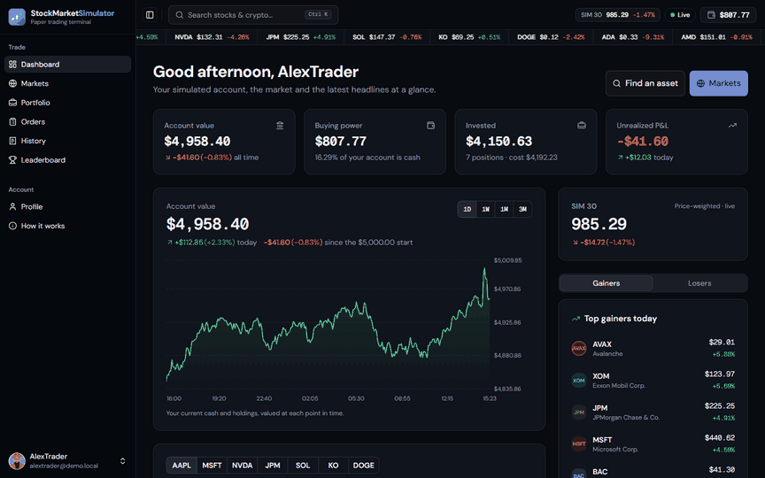
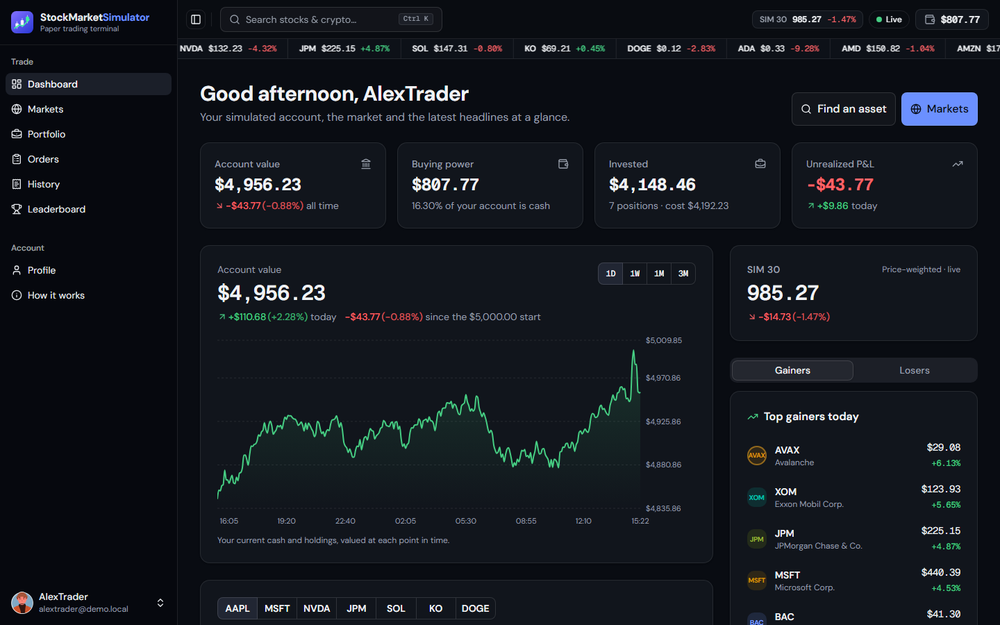
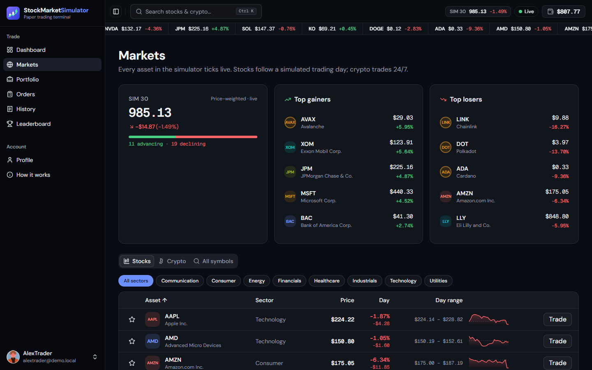
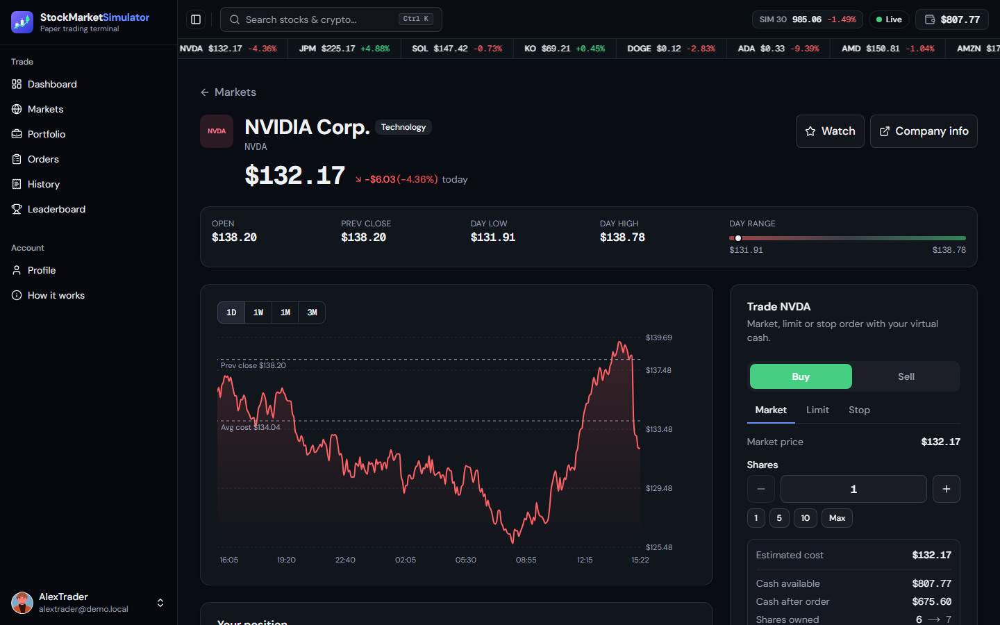
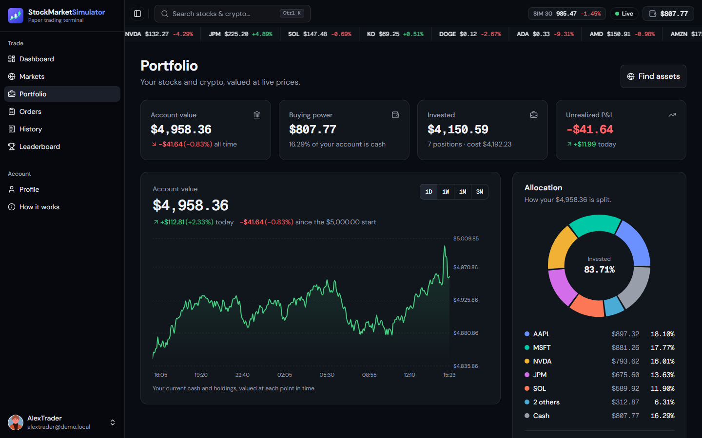
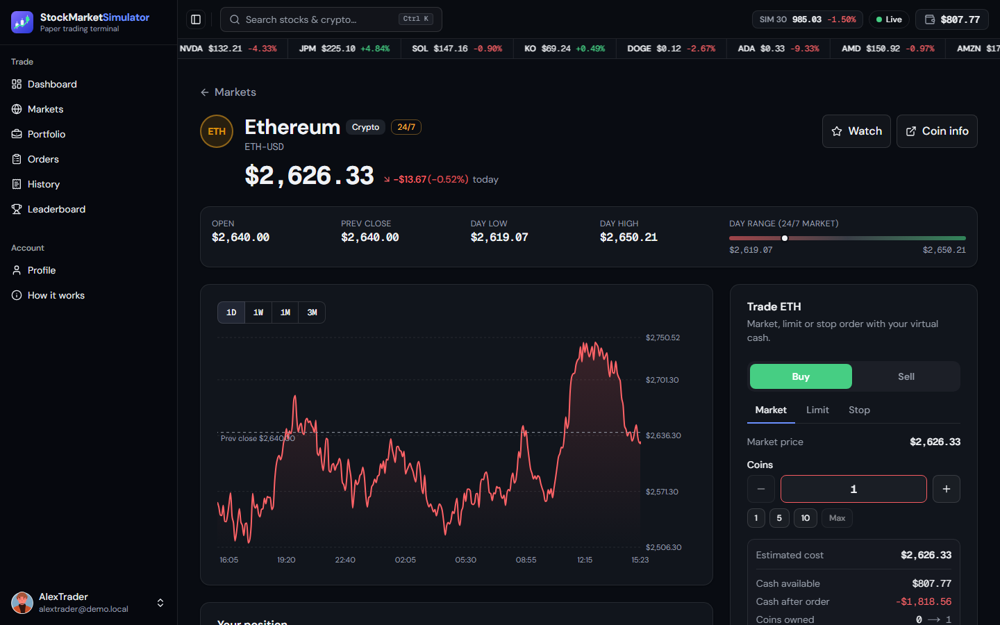
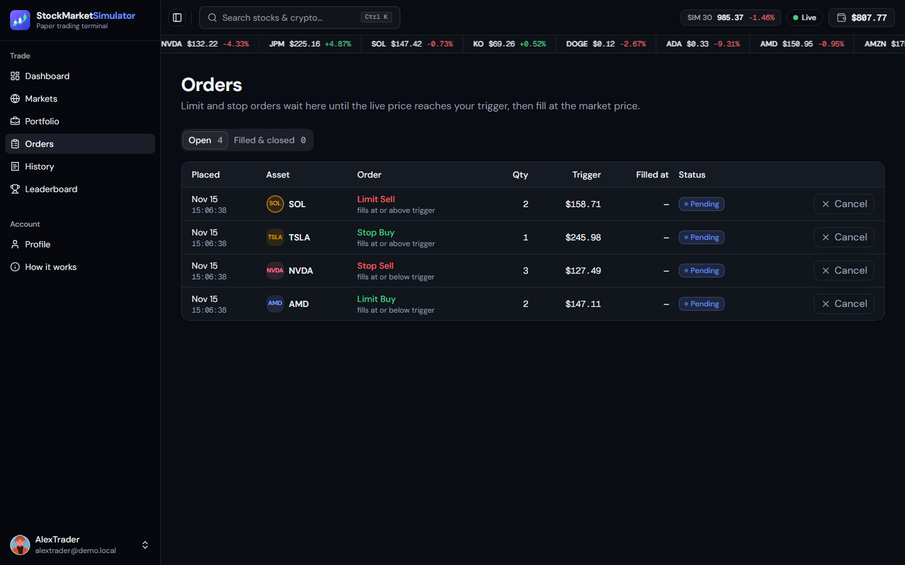
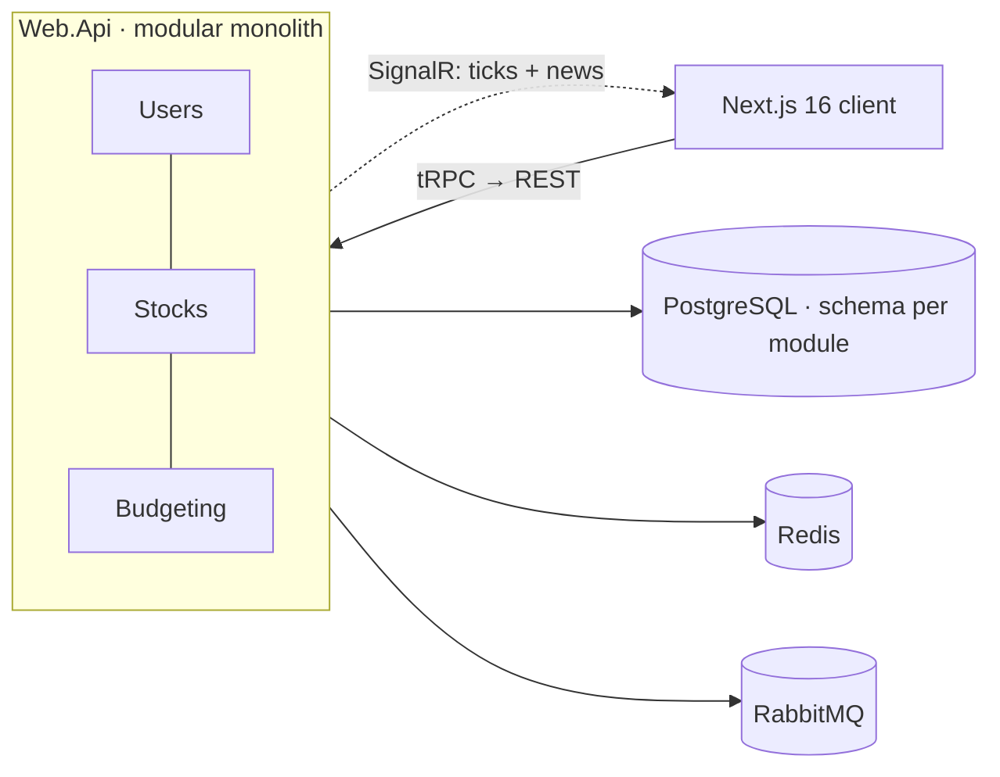

<p align="center">
  
</p>

<h1 align="center">Stock Market Simulator</h1>

<p align="center">
  Paper-trade stocks and crypto with $5,000 of virtual cash in a live, simulated market.<br/>
  .NET 11 modular monolith · Next.js 16 · SignalR · PostgreSQL
</p>

<p align="center">
  
</p>

## Features

- **A market that runs by itself:** 30 stocks and 10 crypto assets tick every second. Prices follow a GBM random walk with a shared market factor, a price-weighted **SIM 30** index and random **news events** that move prices. No API key needed.
- **Real order types:** market, **limit** and **stop / stop-loss** orders. A background job fills them when the live price crosses the trigger.
- **Portfolio tracking:** holdings at live prices, average cost, unrealized P&L, allocation, account value and history.
- **Charts and quotes:** 1D / 1W / 1M / 3M OHLC history, day change against the previous close, open, day range, top gainers and losers.
- **Competition:** a [leaderboard](docs/images/leaderboard.png) of every trader by account value, plus an account reset to start over.
- **Production-style backend:** Clean Architecture modules, CQRS, transactional outbox, RabbitMQ, optimistic concurrency, idempotent writes, rate limiting, OpenTelemetry.

| Dashboard | Markets |
| --- | --- |
|  |  |
| **Stock page and order ticket** | **Portfolio** |
|  |  |
| **Crypto (24/7)** | **Limit and stop orders** |
|  |  |

## Run it locally

You need the [.NET 11 SDK](https://dotnet.microsoft.com/download), [Docker](https://www.docker.com/) (running) and [Bun](https://bun.sh/).

```bash
# 1. Backend: PostgreSQL, Redis, RabbitMQ and Azurite containers, plus the API on http://localhost:5000
dotnet tool restore
dotnet run --project src/StockMarketSimulator.AppHost

# 2. Web client on http://localhost:3000 (in a second terminal)
cd frontend
bun install
bun run dev
```

Open http://localhost:3000, register, and start trading. No `.env`, API key or SMTP server is needed in Development:

- migrations run automatically;
- the market is seeded with price history;
- new accounts are verified automatically.

See [Getting started](docs/getting-started.md) for configuration, troubleshooting and the optional Alpha Vantage key.

## How it's built



| Module | Owns |
| --- | --- |
| **Stocks** | Market universe, the live price simulation, news, quotes, price history, search |
| **Budgeting** | Cash, positions (average cost), trades, limit/stop orders and the fill job, account reset |
| **Users** | Accounts, JWT and refresh tokens, permissions, profiles, followers, the leaderboard |

Modules talk only through small `*.Api` contracts and integration events, and architecture tests enforce that.

**Stack:** .NET 11, ASP.NET Core minimal APIs, EF Core 10 + Dapper, Quartz.NET, SignalR, .NET Aspire 13 · Next.js 16, React 19, tRPC, TanStack Query, Tailwind CSS 4, shadcn/ui, Recharts · xUnit, NetArchTest, Testcontainers.

## Tests

```bash
dotnet test StockMarketSimulator.slnx              # integration and functional suites need Docker
cd frontend && bun run lint && bun run typecheck
```

## Docs

[Getting started](docs/getting-started.md) · [Price simulation](docs/price-simulation.md) · [Architecture](docs/architecture.md) · [Events and jobs](docs/events-and-background-jobs.md) · [Front end](frontend/README.md) · [CI/CD](docs/ci-cd.md) · [Changelog](docs/changelog.md) · [Known issues](docs/known-issues.md)

## License

[MIT](LICENSE)
