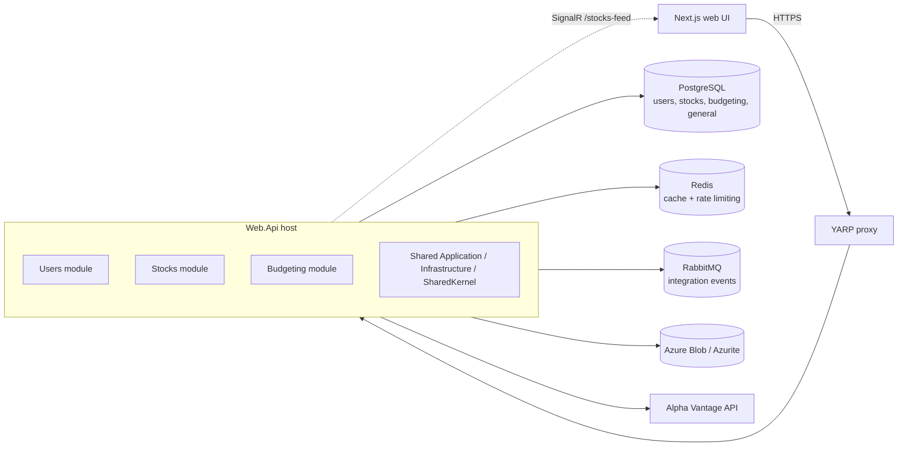

# Architecture

The backend is a **modular monolith**: one deployable (`Web.Api`) made of independent modules. Each module follows Clean Architecture and owns its own database schema.



## Solution layout

```
src/
  SharedKernel/            Entity, Result/Error, Option, Ensure, domain-event contracts
  Application/             Shared CQRS abstractions + pipeline decorators
  Contracts/               Cross-cutting DTOs (paging, email payloads)
  Infrastructure/          Shared infrastructure: messaging, outbox, event bus, caching, storage, auth context
  Modules/
    <Module>/
      Modules.<Module>.Domain          Entities, value objects, domain events, domain services
      Modules.<Module>.Application     Commands, queries, handlers, validators
      Modules.<Module>.Infrastructure  EF Core DbContext, repositories, outbox job, module API implementation
      Modules.<Module>.Contracts       Request/response DTOs
      Modules.<Module>.Api             Public in-process API other modules may call (e.g. IStocksApi)
      Modules.<Module>.IntegrationEvents  Integration-event contracts published on RabbitMQ (Users, Budgeting)
      Modules.<Module>.Events          Integration-event handlers (Users, Budgeting)
      Modules.<Module>.BackgroundJobs  Quartz jobs (emails, audit logs, maintenance) and their schedulers
  Web.Api/                 Minimal-API endpoints, middleware, host composition
  Yarp.Proxy/              Reverse proxy in front of the API (rate limiting, CORS, WebSockets)
  StockMarketSimulator.AppHost/          .NET Aspire orchestration
  StockMarketSimulator.ServiceDefaults/  OpenTelemetry, health checks, service discovery, resilience
frontend/                  Next.js front end (see frontend/README.md)
```

### Module boundaries

| Module | Responsibility | Schema |
| --- | --- | --- |
| **Users** | Registration, email verification, JWT and refresh tokens, permissions, profiles, followers | `users` |
| **Stocks** | Quotes (Alpha Vantage), search, URL shortening, the real-time GBM price feed (SignalR) | `stocks` |
| **Budgeting** | Budgets, buy and sell transactions, positions (holdings), audit logs | `budgeting` |

Modules talk to each other in two ways only:

1. **Synchronously** through another module's `*.Api` project, e.g. Budgeting calls `IStocksApi.GetByTickerAsync` to price a trade.
2. **Asynchronously** through integration events on RabbitMQ (see [events and background jobs](events-and-background-jobs.md)). The event records live in the publishing module's `*.IntegrationEvents` contract project, which depends only on the shared `IIntegrationEvent` abstraction.

`tests/ArchitectureTests` enforces the layer rules: Domain depends on nothing, Application doesn't depend on Infrastructure, and (`Modules/ModuleContractTests`) integration events live only in `*.IntegrationEvents` projects, Application layers don't use Quartz or `Microsoft.AspNetCore.Http` (no `IFormFile`) or the BackgroundJobs/Events projects, and Users BackgroundJobs doesn't use the Budgeting domain. Background work that Application code needs goes through an abstraction such as `IUserJobScheduler`, implemented next to the jobs.

## Request pipeline (CQRS)

Endpoints build a command or query and send it through `ISender` (`Infrastructure/Messaging/Sender.cs`). `Sender` resolves the handler through cached generic wrappers, without MediatR.

Handlers are decorated with Scrutor in `Application/DependencyInjection.cs`, which runs after the modules have registered their handlers:

```
Logging  ->  QueryCaching (ICachedQuery only)  ->  ExceptionHandling  ->  Validation  ->  Handler
(outermost)                                                                          (innermost)
```

- **Validation** runs every FluentValidation validator and returns a `ValidationError` (HTTP 400).
- **ExceptionHandling** awaits the inner handler, so asynchronous exceptions are logged too.
- **QueryCaching** stores successful results under `ICachedQuery.CacheKey`. The cached value is shared by every caller, so per-viewer filtering must happen after the cache. For example, `GET users/{id}` redacts the email address for anyone other than the profile owner, in the endpoint.
- Handlers return `Result`/`Result<T>`. `CustomResults.Problem` maps `ErrorType` to HTTP status codes: `Validation`/`Problem` to 400, `NotFound` to 404, `Conflict` to 409, `Forbidden` to 403, anything else to 500.

## HTTP host (`Web.Api`)

Middleware order in `Program.cs`:

1. `UseExceptionHandler`: first, so every later middleware is covered. `GlobalExceptionHandler` sets the real HTTP status and hides internal messages on 500s.
2. HTTPS redirection, health checks (`/health`), authentication, authorization.
3. `UserContextEnrichementMiddleware` and `RequestContextLoggingMiddleware`. Both await the rest of the pipeline inside their log scope or activity.
4. Status-code pages, the token-bucket rate limiter, response compression.

The `GlobalLimiter` policy (100-token burst, 50 tokens/s) is a Redis token bucket shared by all instances. `GlobalLimiterFactory` builds an in-process token bucket of the same shape instead when Redis was unreachable at start-up, and `RedisFallbackRateLimiter` switches to it whenever a Redis call fails at runtime (logging at most one warning a minute), so rate-limited endpoints degrade to per-instance limits rather than failing.

The API is versioned as `api/v{version}`. `Asp.Versioning.OpenApi` produces one OpenAPI document per version (`openapi/v1.json`), alongside Swagger UI, ReDoc and Scalar in Development. Feature flags gate each area (targeting groups come from the user's role claims and an optional `groups` claim, never from request headers), and permissions are enforced with `HasPermission(...)`, which uses a dynamic policy provider backed by `PermissionRequirement`. Write endpoints such as buy and sell use an `Idempotence-Key` header (`IdempotencyFilter`).

## Persistence

- **EF Core 10 + Npgsql** for writes. Snake-case naming, `EntityFramework.Exceptions` for typed constraint errors, and soft-delete and audit interceptors.
- **Dapper** for read models and hot paths (stock prices, follower queries, outbox processing).
- **Optimistic concurrency** on budgets through PostgreSQL's `xmin` row version. Concurrent trades for the same user can't both commit; the loser gets `Budget.ConcurrentModification` (HTTP 409).
- **Positions.** `budgeting.positions` holds one row per user and ticker (quantity, cost basis), updated in the same transaction as each buy and sell. Cost basis uses the average-cost method: buys add price × quantity, sells remove the sold shares at the current average cost. Sell validation, `purchased-stock-tickers`, the top performer and `GET users/{id}/positions` all read it, so nothing replays the transaction history. The unique `(user_id, ticker)` index also turns two racing first buys into a 409.
- **One row per stock.** `stocks.stocks.ticker` is unique; the first lookup of a ticker upserts.
- Each module calls `InsertOutboxMessagesInterceptor`, which converts raised domain events into outbox rows in the same transaction.

## Caching

- `ICacheService` is backed by Redis (`CacheService`). The process opens **one** `IConnectionMultiplexer`, shared by the distributed cache and the rate limiter.
- If Redis is unreachable at start-up, `PostgresCacheService` takes over, using the unlogged `general.cache_items` table with expirations. An in-memory `IDistributedCache` keeps the idempotency filter working.
- Cache keys are namespaced by area, for example `users:{id}`, `users:{id}:transaction-count` and `shorturl:{code}`.

## Security notes

- JWT bearer authentication. Validation parameters come from validated `JwtOptions` through deferred options configuration.
- Refresh tokens are stored as **SHA-256 hashes** (`refresh_tokens.token_hash`); the plain token is only returned to the client. Changing a password revokes all refresh tokens. Rotation keeps the original absolute expiry. The cleanup job deletes only expired tokens and caps live tokens at 10 per user, so other devices stay signed in.
- Email addresses are normalised (trimmed and lower-cased) in the `Email` value object.
- Blobs record the uploader in metadata (`owner_id`), and `DELETE files/{id}` only lets the owner delete.
- The Alpha Vantage API key and search terms are stripped from HTTP logs.
- Integration events are deserialised through an allow-list binder that accepts only `IIntegrationEvent` types.
