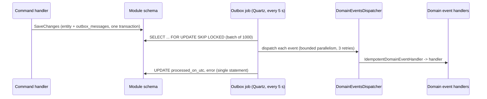

# Events and background jobs

## Domain events and the transactional outbox

1. Entities raise domain events through `Entity.Raise`.
2. `InsertOutboxMessagesInterceptor` serialises them into the module's `outbox_messages` table in the **same transaction** as the state change.
3. Each module has a thin `Process<Module>OutboxMessagesJob` that derives from **`Infrastructure.Outbox.OutboxProcessorJob`** and supplies only its schema and its domain assembly. The base class:
   - locks a batch with `FOR UPDATE SKIP LOCKED`, so several instances can run side by side;
   - deserialises each message, resolving domain event types only from the module's own assembly;
   - dispatches events with bounded parallelism (`MaxDegreeOfParallelism`), retrying 3 times;
   - **records failures per message**. A message that can't be deserialised, or whose handlers keep failing, is stamped with its error instead of failing the whole batch, so a poison message can't block the outbox;
   - stamps the whole batch in a single `UPDATE ... FROM (VALUES ...)`.

### Idempotent consumers

Every `IDomainEventHandler<T>` is wrapped in `IdempotentDomainEventHandler<T>`. Before handling an event it checks `general.outbox_message_consumers` for the pair *(event id, handler name)*, and records it afterwards.

- The table's primary key is **`(id, name)`**, so one event can have any number of handlers.
- `CachedOutboxMessageConsumerRepository` caches only *positive* lookups. Caching "not consumed yet" would let a retried event run a handler twice.

## Integration events (RabbitMQ)

Some domain event handlers publish **integration events** through `IEventBus`, for example `UserCreatedIntegrationEvent` and `TransactionBoughtIntegrationEvent`.

| Piece | Behaviour |
| --- | --- |
| `EventBus` (singleton) | Opens the connection and channel once, lazily. Publishes are serialised with a semaphore, because a RabbitMQ channel isn't thread-safe. Messages are persistent. A broken channel is dropped and recreated on the next publish |
| `IntegrationEventSerializer` | JSON with the concrete type in a root `$type` property. On deserialisation an **allow-list binder** only instantiates `IIntegrationEvent` implementations |
| `IntegrationEventProcessorJob` (every 5 s) | Opens one connection per run and drains up to 100 messages. Undeserialisable messages are rejected without requeue. When a handler fails, the message is requeued and the run stops, so the queue doesn't spin on it |
| `IntegrationEventsDispatcher` | Resolves every `IIntegrationEventHandler<T>` for the event in a fresh scope |

Integration event handlers live in `Modules.<Module>.Events`. They mostly schedule one-off Quartz jobs (emails, audit logs, budget creation) with job data.

## Quartz jobs

Recurring jobs are registered in `Web.Api/Extensions/BackgroundJobExtensions.cs` with Quartz 4's typed `ScheduleJob<TJob>`:

| Job | Interval | Purpose |
| --- | --- | --- |
| `ProcessUserOutboxMessagesJob` / `ProcessStockOutboxMessagesJob` / `ProcessBudgetingOutboxMessagesJob` | 5 s | Outbox processing per schema |
| `IntegrationEventProcessorJob` | 5 s | RabbitMQ consumer |
| `RevokeExpiredRefreshTokenJob` | 20 s | Refresh-token cleanup |
| `UpdateLatestStockPriceJob` | 1 min | Refreshes stale stored prices from Alpha Vantage, oldest first. Failures are isolated per ticker |
| `StocksFeedUpdater` | `StockUpdateOptions:UpdateIntervalInSeconds` | Real-time GBM price step and SignalR broadcast ([details](price-simulation.md)) |

One-off jobs (`EmailVerificationJob`, `UserEmailVerifiedJob`, `PasswordChangedJob`, `TransactionBoughtJob`, `TransactionSoldJob`) read their parameters with the typed helpers in `Infrastructure/BackgroundJobs/JobDataMapExtensions.cs` (`GetGuid`, `GetDecimal`, `GetDateTime`). Quartz 4 provides `GetString` and `GetInt` itself.

Jobs implement Quartz 4's `ValueTask Execute(IJobExecutionContext, CancellationToken)`.
